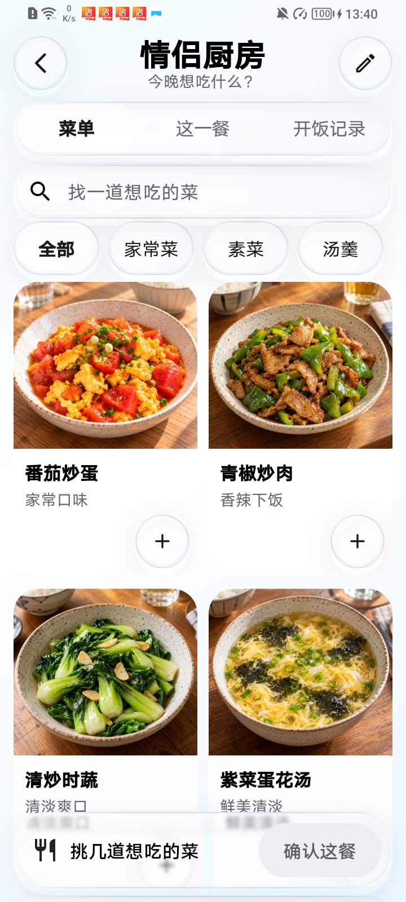
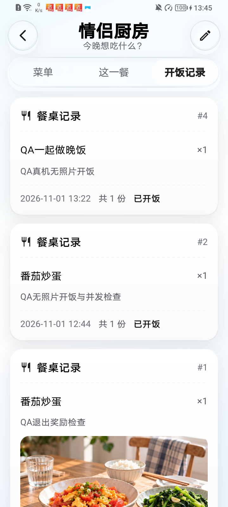

# 厨房照片菜单：参考图对照与验收边界

归档日期2026-11-06。截图分别采集于11月1日和11月6日，时间与源码/APK散列见`clear-kitchen-honor-20261101/menu-manifest.json`。这份记录只证明列出的页面和操作，不代表完整厨房、旅行准备或全App目标完成。

## 实现与参考图

对应`docs/design/clear-app-20261031/08-kitchen-menu.png`。厨房已从侧边分类和小照片列表，改为冷白淡蓝背景、玻璃返回/管理按钮、菜单／这一餐／开饭记录三段导航、搜索、横向分类、两列真实照片和固定确认托盘。个人菜单在右上管理入口与生活页“我的菜单”进入；未绑定也可先添加自己的菜。主页面不注入示例菜单。

- 图稿外边距约27/841宽，实际24/720；图稿列间距约20/841，实际20/720；照片窗实际比例1.1，图稿约1.12。原字号下首排照片起点从候选01的594物理像素上移到02的500，顶部字阶与未选导航也已减轻。
- 数量按钮复用48逻辑像素玻璃控件，包含按压与动效偏好；搜索、分类不会清掉已选菜。数量最多9份，与现行后端一致，避免客户端显示数量被后台截断。
- 正常字号下第二排数量操作需要滚动后触达；已在荣耀实际滚动并选中时蔬。没有把被固定托盘覆盖的初始坐标描述为直接可点击，也没有用生成图替代真机。
- 历史页曾误用默认竖向84逻辑像素的分隔线，两个分隔线造成大块空白；日期行亦在回归中复现右侧溢出。现改为横向分隔、可换行日期摘要，显示真实份数/留言/可选照片，退出无意义的零金额强调、装饰条码与倾斜“已开火”章。单菜回归高度从339降到250以下；荣耀含留言的实际卡片约199逻辑像素。

原字号亮色：

历史页修正后：

## 已核验的操作

| 范围 | 实际证据 |
|---|---|
| 照片与选择 | 四道菜均来自隔离账号正常接口；选番茄炒蛋和时蔬、滚动、清空搜索后选择保持，照片详情能打开/返回 |
| 搜索与键盘 | 荣耀打开搜索键盘、输入无结果查询、清空并收起键盘，返回原菜单；中文关键词与分类保留选择由组件检查覆盖 |
| 餐次状态 | 候选01真机撤销接单、重新接单、无照片开饭成功；普通API确认QA订单4完成、照片null、奖励标记false |
| 失败重试 | 仅停止自有QA容器，真机提交失败后保留确认弹层，订单仍accepted；恢复QA后同一弹层重试完成。正式服务PID/启动时间未变化 |
| 账号 | 同一荣耀通过普通登录切换两个QA账号：女方仅看到男方菜单，旧选菜未带入；女方自己的四道菜在个人管理页可见。恢复男方QA会话；不是两部手机联调 |
| 加载/失败/未绑定 | 未绑定个人建菜、菜单失败不冒充未绑定、失败后重试、缺图和长文本由组件检查覆盖；真实未绑定设备场景尚未补齐 |
| 亮暗与字号 | 11月1日原字号亮色已操作；11月6日取得原字号深色及1.4字号深色截图。大字号完整交互仍待补齐，原亮色和1.15字号已恢复并核对 |

候选02内部APK为63,659,281字节，SHA256=`3a6f2a464a28c8a9bd5a45e0d39e6e9b713ffe3ac9cb041d62907c3529bca7a8`，只指向loopback QA，沿用内部187码，未发布到正式服务器。11月6日重新读取手机APK散列及当前源码，均与该候选记录一致。

## 素材、检查和后续

四张菜单照片用内置`image_gen`生成/重构，仅上传隔离账号。原素材和完整提示词见`docs/design/clear-app-20261031/fixtures/kitchen-photos-manifest.json`；未声明为APK素材，也未写生产菜单。原厨房装饰封面保留原文件。

本轮源码全套226项检查与analyze0已通过，原始日志在本地备份目录`kitchen-grid-02-full-tests-final.log`和`kitchen-grid-02-analyze-final.log`。新增回归覆盖两列几何、筛选不丢选择、未绑定建菜、接口失败重试、360宽亮暗/大字号、餐次入口和数量上限。检查数量不等于视觉或功能全部达标。

检查还复现Windows下已有草稿目录删除的错误145，另有formatter文件映射占用1224。尚未确认占用进程；只为Windows145加入最多200ms的有限重试，其他错误继续抛出，账号/目录约束及业务断言保留。新增连续10组排队写入/删除检查通过，独立回滚提交`a4ae32b`；Android正常删除路径未增加等待。

11月6日原测试服务处于exited，恢复自有QA容器并重建本地/USB转发。工具解释器已更换，在备份目录创建独立Python313环境安装所需依赖，未修改App依赖或导出凭据。重新读取10个正式业务路由，与原live快照一致；没有向正式业务接口或数据库写入。11月1日的68表指纹检查仍只代表当时的验证范围。

本次图片重连时暴露了载入期间留白；四个图片地址HEAD均200、各约2.2—2.6MB，未发现图片解码或HTTP错误。后续应补明确加载状态，并在完整厨房流程中检查照片列表的传输与缩略图，保留原图。

检测到最后一次指令后另有触摸且列表移动，按约定暂停；用户回复无人操作并授权恢复。滚动原因未确定，不认定人工操作。原亮色／1.15已恢复并核对，证据在display-restored-20261106.json。每餐修改/协商、轮换主厨、防重复下单、食材做法持久化、美食手账唯一关联仍未完成；完整性能测量、其他页面和旅行准备继续执行。
